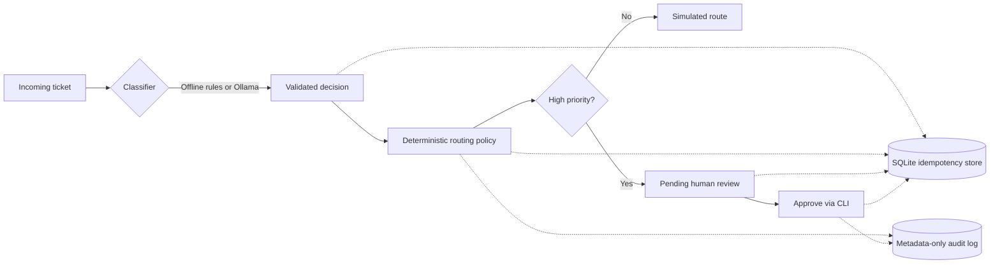

# AI Workflow Automation Patterns

**Practical patterns for building reliable AI-assisted workflows with human oversight.**

This open-source reference project demonstrates a realistic support-ticket triage workflow: classify an incoming ticket, apply deterministic business rules, route it to a simulated destination, and require human approval for high-priority items.

> **Status:** Educational reference / v0.1.0. The example does not send emails, create real tickets, or execute external business actions.

## Why this repository?

Real automation systems need more than an LLM call. They need validated model output, deterministic routing, duplicate prevention, review gates, bounded retries, and observable outcomes. This project shows those building blocks in a small, inspectable Python application.

### Features

- **Two classification modes:** rule-based offline demo, or a real local LLM through Ollama.
- **Structured, validated decisions:** constrained categories and priorities; model text is never executed.
- **Human-in-the-loop:** high-priority tickets are queued for an explicit approval action.
- **SQLite idempotency:** reprocessing the same ticket ID and payload returns its earlier result; conflicting reuse is rejected.
- **Privacy-conscious audit log:** event metadata, not ticket bodies or model prompts.
- **No runtime Python dependencies:** Python standard library; Ollama is optional.
- **Unit tests and GitHub Actions CI.**

## Architecture



Read the [architecture](docs/architecture.md), [reliability patterns](docs/patterns.md), and [security considerations](docs/security.md).

## Quick start (offline; no API key)

Requires **Python 3.11+**.

```bash
git clone https://github.com/codhaus32/ai-workflow-automation-patterns.git
cd ai-workflow-automation-patterns
python -m pip install -e .
python -m ai_workflow_patterns run --input examples/tickets.json --provider rules
```


> The project can also run without installation using `PYTHONPATH=src python -m ai_workflow_patterns ...` on macOS/Linux, or by setting `PYTHONPATH` in your shell.

The tool prints a JSON summary. **No live integrations are invoked.** Local state defaults to `.state/workflows.sqlite3` and `.state/audit.jsonl` (both gitignored).

Re-running the same input returns the stored result instead of executing the workflow again. To start fresh, remove the `.state/` folder.

### Human approval example

The sample ticket `T-1002` is high priority and will be placed in `pending_approval`:

```bash
python -m ai_workflow_patterns approve --ticket-id T-1002 --approver demo-reviewer
```

Approval updates the stored workflow status; it **does not** send any outbound message or perform an actual business action. The `--approver` value is a demo identifier, not an authenticated identity.

### Use a local LLM (Ollama)

1. Install and start [Ollama](https://ollama.com/).
2. Pull a model appropriate for your machine, e.g. `ollama pull llama3.2`.
3. Run:

```bash
python -m ai_workflow_patterns run --input examples/tickets.json --provider ollama --model llama3.2 --db .state/ollama-workflows.sqlite3 --audit .state/ollama-audit.jsonl
```

Model availability and performance depend on your Ollama setup. Model responses are schema-checked; invalid classifications fail closed instead of being silently accepted. See [Ollama integration](docs/ollama.md).

## Folder layout

```text
ai-workflow-automation-patterns/
├── src/ai_workflow_patterns/
│   ├── __main__.py        # CLI: run and approve
│   ├── models.py          # Typed models and validation
│   ├── providers.py       # Offline rules and Ollama LLM
│   ├── engine.py          # Routing rules and orchestration
│   ├── storage.py         # SQLite idempotency and approvals
│   └── audit.py           # Metadata-only JSONL events
├── examples/tickets.json  # Synthetic input
├── tests/                 # Offline unit tests
├── docs/                  # Architecture, patterns, security
└── .github/workflows/     # CI test runner
```

## Run tests

```bash
python -m unittest discover -s tests -v
```

## What this project intentionally does not do

This repository is **not** an autonomous agent framework or a production-ready helpdesk integration. It does not verify an approver's identity, encrypt the SQLite database, provide worker queues, handle concurrent event delivery across hosts, or connect to a live CRM. See [production checklist](docs/architecture.md#production-checklist) for the next steps.

## Contributing

Ideas and bug fixes are welcome. Please read [CONTRIBUTING.md](CONTRIBUTING.md). For security reports see [SECURITY.md](SECURITY.md).

## Maintainers and further reading

Maintained by [Codhaus](https://codhaus.com/), a software and AI engineering team. For a broader discussion of integration and implementation considerations, see its [AI workflow automation resource](https://codhaus.com/services/ai-solutions/ai-workflow-automation-saudi-arabia/).

## License

This project is open-source and licensed under the MIT License.

Copyright (c) 2026 Codhaus.

You are free to use, modify, distribute, and build upon this project in accordance with the terms of the MIT License.

For complete licensing details, see the [LICENSE](LICENSE) file.
