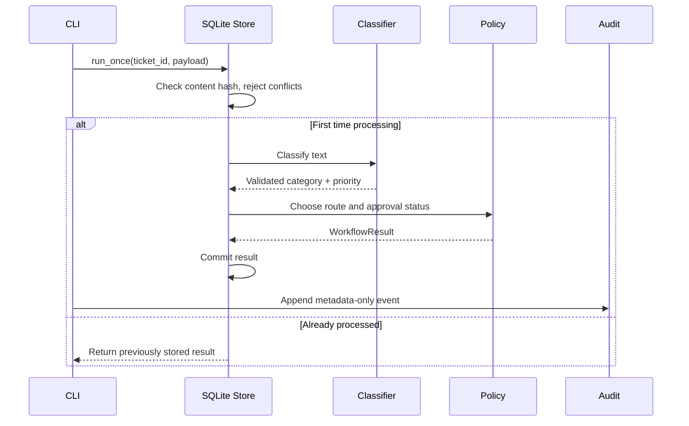

# Architecture

## Scope

This is a small, synchronous **reference implementation**, not a hosted automation platform. All input tickets are synthetic examples and all routes are simulated. The only outbound network call available is the optional request to a local Ollama inference endpoint.

## Event lifecycle

**Important limitation:** The audit JSONL append happens after the DB commit; a crash between them can lose an audit event. Production systems should use a transactional outbox with an event dispatcher, rather than treating separate storage writes as an atomic operation.

## Trust boundaries

1. Input JSON is validated for required strings and maximum lengths.
2. The classifier returns only `category` and `priority` from strict allowlists.
3. Routing maps categories to hard-coded queue names; model output cannot select URLs, tools, commands, or recipients.
4. `pending_approval` requires a separate CLI transition, but this is not authenticated authorization.
5. Ticket body and LLM prompts are not written to the demo audit log. SQLite stores hashes and derived decisions, not ticket bodies.

## Production checklist

- Replace single-node SQLite with a transactional datastore and explicit row-level tenant isolation, if multi-tenant.
- Add job queue and background workers, dead-letter queue, distributed idempotency and outbox.
- Move model calls outside long-lived SQL transactions via leases/claim tokens.
- Authenticate reviewers, implement role-based approvals and separation of duties.
- Add encrypted data storage, access logs and retention controls.
- Add observability with trace IDs and metrics (errors, queue latency, model cost).
- Rate-limit, budget, and monitor model calls. Add fallbacks and human review for uncertain outputs.
- Add integration tests, red-team prompt-injection tests, and security review before any live side effects.
